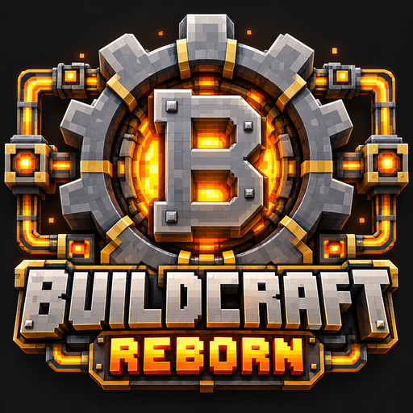

<p align="center"></p>

# BuildCraft Reborn

An unofficial port of BuildCraft 8.0 from Minecraft 1.12.2 to **Minecraft 1.21.1 on NeoForge**. It is not affiliated with SpaceToad or the BuildCraft Team.

## Status

**Version 2.0.0 is the first release out of beta**, with the guide book in all 31 languages. 1.3.0 added robot goggles, which BuildCraft started after 7.1 and never finished; 1.2.0 added BuildCraft 7.1's crafting by package (1.2.1 EMI support, 1.2.2 other mods' refined fuels, and 1.2.3 complete translations), after 1.1.0 added 7.1's robots (8.0 never got as far as either), on top of 1.0.0-rc.1, which ported everything 8.0 had. The foundation every machine is built on is ported, and so are BuildCraft's core, energy, factory, transport, silicon, builders and robotics modules, the guide book, and support for JEI, EMI, Jade, The One Probe and CraftTweaker:

- **Engines:** redstone, stirling, combustion and creative, with their GUIs, the power, owner and help ledgers, heat, overheating and the moving piston.
- **Wrench:** rotates BuildCraft blocks and vanilla blocks (chests, furnaces, pistons, stairs, doors and the rest of 1.12's list).
- **Oil and fuels:** all 30 fluids (oil, residue, heavy oil, dense oil, distilled oil, dense fuel, mixed heavy fuels, light fuel, mixed light fuels and gaseous fuel, each cool, hot and searing), with buckets. Breaking a tank drops its fluid as fragile fluid shards.
- **Fuels and coolants** are data maps, so a datapack can add or change them: `data/buildcraftreborn/data_maps/fluid/{fuels,coolants}.json` and `item/solid_coolants.json`.
- **Oil wells** generate in the world: surface lakes with branching tendrils, an underground pocket, oil spouts, and for large wells a shaft down to an oil spring at the bottom of the world. Deserts and oceans have the most oil.
- **Markers:** volume markers ("Land Mark") and path markers ("Path Mark"), the marker connector, and their lasers.
- **Springs and decorations:** the water and oil springs and the six decoration blocks (creative only, as in 1.12).
- **Factory machines:**
  - **Tank:** 16 buckets; tanks stacked on top of each other act as one column (fluid sinks to the bottom), show the fluid inside, and give a comparator signal.
  - **Mining well:** digs straight down with a tube, putting what it mines into a neighbouring pipe or inventory, or onto the ground.
  - **Pump:** lowers a tube to the nearest fluid below and pumps the whole pool (water pools of 9 or more count as infinite, as in 1.12). It finds oil springs for the oil advancements.
  - **Flood gate:** fills the area below and beside it with the fluid in its tank; the wrench opens and closes each side.
  - **Chute:** picks up items that land on its open end and pushes them into the inventories beside it.
  - **Auto workbench:** crafts the recipe laid out in its pattern grid from the items it holds, slowly and without power.
  - **Distiller:** splits oil and fuels into a gas and a liquid with MJ, with its animated GUI and moving power blocks.
  - **Heat exchanger:** three to five in a row heat one fluid with another (oil with lava, for example), with the fluids flowing through it. The wrench turns a lone one and swaps the ends of a full one.
  - **Water gel:** the water gelifier turns water into gel, which spreads and sets; gelled water crafts back into a water bucket.
- **Refinery recipes** (distillation, heating and cooling) are data maps too: `data/buildcraftreborn/data_maps/fluid/{distillation,heatable,coolable}.json`.
- **Oil and fuel are shared with other mods** through common fluid tags: oil is in `c:oil` and `c:crude_oil`, light fuel in `c:fuel` and `c:light_fuel`, and gaseous fuel in `c:gaseous`. Other mods' fluids in those tags work in BuildCraft's machines too: oil burns, heats and distils like BuildCraft's oil, and fuel burns like light fuel. So, for example, PneumaticCraft refines BuildCraft's oil, BuildCraft's engines burn PneumaticCraft's oil, and Ad Astra's rockets fly on BuildCraft's fuel.
- **Other mods' refined fuels burn in the combustion engine** (from 1.2.2), each with its own values, on BuildCraft's scale (light fuel is 6 MJ/t for 750 s):

  | Fuel (tag) | Power | Burns for | A bucket | Made by |
  | --- | --- | --- | --- | --- |
  | Gasoline (`c:gasoline`) | 7 MJ/t | 600 s | 84,000 MJ | PneumaticCraft, Create: Diesel Generators, TFMG |
  | Kerosene (`c:kerosene`) | 6 MJ/t | 750 s | 90,000 MJ | PneumaticCraft, TFMG |
  | Diesel (`c:diesel`) | 5 MJ/t | 960 s | 96,000 MJ | PneumaticCraft, Modern Industrialization, Oritech, Create: Diesel Generators, TFMG |
  | Biodiesel (`c:biodiesel`) | 5 MJ/t | 800 s | 80,000 MJ | PneumaticCraft, Modern Industrialization, Immersive Engineering, Oritech, Create: Diesel Generators |
  | Ethanol (`c:ethanol`, `c:bioethanol`) | 4 MJ/t | 625 s | 50,000 MJ | PneumaticCraft, Modern Industrialization, Immersive Engineering, Create: Diesel Generators, Mekanism Generators |
  | LPG (`c:lpg`) | 8 MJ/t | 500 s | 80,000 MJ | PneumaticCraft, TFMG |
  | High power biodiesel, boosted diesel (`c:high_power_biodiesel`, `c:boosted_diesel`) | 6 MJ/t | 1,000 s | 120,000 MJ | Immersive Engineering, Oritech, Modern Industrialization |

  Some mods put all their fuels in `c:fuel` as well; a fuel named here burns with these values anyway, and anything only in `c:fuel` burns like light fuel. Data packs can change all of them in the fuel data map.
- **Pipes:** all 47 of 8.0's pipe types.
  - **Transport pipes** for items: wooden (extracts with engine power), cobblestone, stone, sandstone, quartz, golden, iron (routes), diamond (sorts, with its filter GUI), wooden diamond (round-robin extraction), clay (prefers machines), void, obsidian (sucks up items), lazuli (paints items), daizuli (routes painted items), emzuli (gate-controlled extraction presets) and stripes (places, breaks, plants, shears, uses and dispenses, and extends itself with pipes).
  - **Fluid pipes** (wooden, cobblestone, stone, sandstone, quartz, golden, iron, diamond, wooden diamond, clay and void), made waterproof with pipe sealant. The obsidian fluid pipe is registered but, as in 1.12, has no item.
  - **Kinesis pipes** carry MJ, with the diamond and iron limiters, and **energy pipes** (1.12's "Redstone Flux" pipes) carry NeoForge energy (FE).
  - The cobblestone **structure pipe** holds facades and wires without carrying anything.
  - Transfer rates and the wooden pipes' power cost are in `config/buildcraftreborn-transport.toml`.
  - Pipes show what they carry: moving items, fluid levels and power flow. Painted pipes (paintbrush) don't join pipes painted another colour, and turning an item pipe into a fluid pipe with sealant (or back) keeps its paint.
- **Plugs:** the blocker and power adapter, and from silicon the gate, lens, filter, pulsar, light sensor, timer and facade.
- **Pipe wires** in 16 colours run along pipes and carry gate signals.
- **Gates:** basic, iron, nether brick and golden, AND and OR (better materials have more trigger and action slots), with lapis, quartz and diamond modifiers for more parameters. The gate GUI drags triggers and actions from the side panels, with parameters (item filters, levels, colours, sides). The core, transport and silicon triggers and actions are all here: redstone, machine state, inventory and fluid levels, power, engine heat, items and fluids traversing, wire signals, pipe colour and direction, power limits, extraction presets, the pulsar, the light sensor and the timer. The gate copier copies a gate's setup to another.
- **Filtered buffer:** a 9-slot buffer that only accepts the items set in its filter.
- **Silicon machines:** the **laser** sends MJ to the tables in front of it, with its beam. The **assembly table** builds chipsets, gates, plugs, lenses, wires and facades from recipes you pick in its GUI. The **advanced crafting table** crafts a blueprint grid from stored items with laser power, and the **integration table** has its GUI and recipe type ready (8.0 had no recipes for it).
- **Facades** can be made of about 2,400 vanilla block states (every one 1.12's rules accept, including glass and other see-through blocks), solid or hollow. A solid facade stops the pipe connecting on that side. Facades have their own creative tab.
- **Paintbrush:** 16 colours and a clean one, 64 uses before it needs re-dipping in dye.
- **Assembly recipes** are data recipes (`buildcraftreborn:assembly`), so a datapack can add or change them; the integration table reads `buildcraftreborn:integration` recipes the same way.
- **Builders:**
  - **Quarry:** builds a frame around the area of the volume markers behind it (or an 11x11 area by default), then mines the whole area out with its drill, layer by layer, down to the bottom of the world. What it mines goes into a neighbouring pipe or inventory, or drops on the ground if there is none. It keeps the chunks of its area loaded (see the lib config's chunk loading options), shows an item hatch on each side that has an inventory, and takes its frame down when broken. `config/buildcraftreborn-builders.toml` has the quarry's speed limits and minimum frame height.
  - **Filler:** builds one of 19 patterns (clear, fill, box, frame, pyramid, stairs, sphere and its parts, and eight 2D shapes, with their parameters) in the area of its markers or volume box, from the blocks in its inventory, with a little robot and flying blocks. It can invert the pattern and break blocks in the way. A gate can set its pattern and turn it off, on or to loop.
  - **Architect table:** scans the area of its markers or volume box into a blank **blueprint** (blocks, with their contents and settings, and entities such as item frames, paintings, armour stands, boats and minecarts) or **template** (just where blocks are), named in its GUI.
  - **Builder:** builds a blueprint or template behind itself, or at each step along a path of path markers, using the items and fluids it holds; the GUI lists what a blueprint still needs.
  - **Electronic library:** copies blueprints and templates from the server to the player's own library (on their computer), and back, so they can be used in other worlds and on other servers.
  - **Replacer** (creative): swaps one block for another in a blueprint, using two single schematics.
  - **Single schematic** (creative): copies one block, then places copies of it with your items.
  - **Volume boxes** (creative): the volume box item makes a box that the marker connector resizes, and the **filler planner** addon shows a filler pattern inside it, which a filler next to the box builds.
  - Blueprints, templates and single schematics show a 3D preview in their tooltip. Which blocks and entities are copied, and what they need, comes from schematic rules in `assets/<mod>/compat/buildcraft/builders/` (rewritten for 1.21's blocks), so other mods can add theirs.
- **Robotics:** BuildCraft 7.1's robots, and 8.0's zone planner.
  - **Robots** live on **docking stations** (pipe pluggables): they fly out to work, come back to sleep when there's nothing to do, and recharge at stations on kinesis pipes. A robot holds 10,000 MJ and gives off red puffs as it uses it.
  - What a robot does comes from its **redstone board**, all 17 of 7.1's: picker, carrier, tank (fluid carrier) and delivery; lumberjack, harvester, miner, planter, farmer, leaf cutter, butcher, shovelman and pump; knight and bomber; stripes and builder.
  - Blank boards are programmed in the **programming table** and put into robots in the **integration table**; the **charging table** charges robots (and Forge Energy items). All three are laser tables.
  - A gate on a station's pipe runs the station and its robot with 7.1's actions and triggers: provide, accept and request items and fluids, work or load and unload in an area, item and tool filters, wake up, go to a station, forbid or force robots, and robot sleeping, docked, linked and reserved triggers. Areas are zone planner zones on a map location, or any other map location area.
  - The **requester** asks delivery robots for items (20 requests, each a whole stack), and the **construction mark** holds a blueprint for builder robots to build.
  - Robots wear helmets and mob heads. A sneaking right click with a wrench turns a robot back into its item, with its board and power.
  - **Robot goggles** (new in 1.3.0; BuildCraft never finished them): while you wear them, robots glow through walls, red when a robot's battery is empty, yellow when it's half full and green when it's full, and laser beams the client config hides show anyway. Made from leather, glass panes and a redstone chipset; no protection, and they never wear out.
  - The **zone planner**'s GUI shows a 3D map of the land around it that can be panned and zoomed, zones are painted on it with paintbrushes (16 colour layers), and a map location can copy a zone in or out. Its screen shows a small map of the area.
- **Crafting by package** (BuildCraft 7.1's, which 8.0 didn't port):
  - The **recipe packager** packs a crafting recipe's ingredients into a **package**. Each slot of its 3x3 pattern asks for an item or for "anything" (all the "anything" slots get the same item, one no slot names); it takes the ingredients from its nine storage slots and the inventories on its four sides, and turns a piece of paper into a package with each item in its slot. A package with empty slots can go round again to have them filled.
  - The **stamping table**, a laser table, crafts a package's grid (40 MJ for each item), and crafts any other item on its own as a one-item recipe. What can't be crafted moves on unchanged, and what a recipe leaves behind (empty buckets) goes in its leftover slots.
  - Packages show their grid in their tooltip. Thrown by hand, a dispenser or a stripes pipe, a package bursts where it lands and drops what it holds.
- **Tools:** the **list** (two lines of filter items, matching exactly, by type or by material, with a label), the **map location** (marks a spot, an area, a path or a zone), and the **debugger** (adds a machine's internal state to the F3 screen).
- **RF engine and MJ dynamo:** the RF engine turns NeoForge energy (FE) into MJ and the MJ dynamo turns MJ into FE. Both are off by default, as in 1.12: turn on `enableRfEngine` and `enableMjDynamo` in `config/buildcraftreborn-energy.toml` for their recipes and creative tab entries.
- **Guide book:** BuildCraft's own guide, with all 107 pages from 1.12's BuildCraft Guide (blocks, items, pipes, triggers, actions and configuration) and 11 new ones for the robots, boards, docking station, robot goggles, tables, requester, construction mark, recipe packager, stamping table and package, crafting, smelting and assembly recipes and uses on each item's page, three ways of sorting the contents, search, chapter bookmarks, and lore and hints that can be turned on and off. Pages are markdown files in `assets/<mod>/compat/buildcraft/guide/<language>/`, so resource packs and other mods can add their own (F3 + T reloads them). Every page is in all 31 languages (from 2.0.0).
- **Translations:** 31 languages with every line translated (from 1.2.3): the 30 of 1.12's BuildCraft, and Serbian in both scripts (Minecraft's `sr_sp` is Cyrillic and `sr_cs` Latin). BuildCraft's community translations are kept wherever they exist; the rest, about two thirds of the text in most languages, was translated for this port by an AI model (Claude) using each language's existing BuildCraft terms, and hasn't been checked by native speakers yet. The guide book's 118 pages were translated the same way in 2.0.0. Corrections are welcome on the [issue tracker](https://github.com/Reiko45/BuildCraft-Reborn/issues).
- **JEI** (optional): assembly table recipes (including every facade), programming table boards, robot programming in the integration table, distiller, heat exchanger (heating and cooling) and combustion engine fuel and coolant recipes, with their machines as catalysts; the stirling engine for furnace fuels; the auto workbench, advanced crafting table and stamping table as crafting tables, with recipe transfer into the blueprints and into the recipe packager's pattern; clickable progress arrows; items dragged from JEI into filter, blueprint and pattern slots; and gates, lenses, facades, paintbrushes, guide books, robots and boards listed one by one.
- **EMI** (optional): the same recipes and workstations as JEI, EMI's fill button for the blueprints, the packager's pattern and the assembly table, dragging into filter, blueprint and pattern slots, and the same items listed one by one. EMI has no click areas, so the progress arrows aren't clickable there. With JEI installed too, EMI uses this support rather than the JEI plugin.
- **Jade and The One Probe** (optional): what an auto workbench or advanced crafting table is making and from what, how much power a laser table is waiting for, an engine's output, stored power and heat, and how much MJ other machines hold.
- **CraftTweaker** (optional): `<recipetype:buildcraftreborn:assembly>` adds and removes assembly recipes; `mods.buildcraftreborn.Refinery` adds heat exchanger and distiller recipes and `mods.buildcraftreborn.CombustionEngine` adds fuels and coolants. See [CraftTweaker](#crafttweaker) below.
- **Advancements** for the above.

A **test machine** takes MJ from engines and has a tank and an item slot. It is only registered in development runs (`runClient`, `runServer`, GameTests); a built jar leaves it out of the game. Get it with `/give @s buildcraftreborn:test_machine`.

### How it differs from 1.12

- **No oil biomes.** 1.12 added Oil Desert and Oil Ocean biomes. Here oil wells generate in ordinary biomes, and the biome tag `#buildcraftreborn:oil/excessive` (deserts and oceans by default) makes them 30 times more likely, as the oil biomes did. `#buildcraftreborn:oil/surface_deposit` and `#buildcraftreborn:oil/excluded` replace 1.12's other biome lists, and the energy config (`config/buildcraftreborn-energy.toml`) has the well chances, spout heights and dimension list. If there is too much oil in oceans, take `#minecraft:is_ocean` out of the excessive tag with a datapack.
- **One block per type.** 1.12's engine, spring and decoration blocks used metadata; each type is its own block now (`engine_stone`, `oil_spring`, `decorated_paper`, ...).
- **Oil floats on water.** BuildCraft fluids follow their density when they meet another fluid, so oil slicks stay on the sea instead of sinking through it, and residue sinks.
- **Fixes:** the stirling and combustion engines' ledgers show their real output (1.12 showed 0 or a made-up number), oil springs remember their well's size after a reload, the shaft of large wells stays one block wide with spouts turned off, and the area kept free of oil in The End is a square around the main island (1.12's check excluded two long strips).
- **Water springs** don't generate in the world, which matches 8.0 (its populator was never registered).
- **Factory block states.** What 1.12 worked out while drawing is stored in the block state now, so models (and resource packs) can use it: a tank's `joined_below`, a chute's `connected_<side>` spouts, a flood gate's open sides, and a heat exchanger's `part` (start, middle or end) and `connected_left`/`connected_right`. The heat exchanger's 1.12 variable model is converted into plain model parts.
- **Factory fixes:** the heat exchanger keeps the fluid at its start after a reload (1.12 emptied it), the flood gate checks the right blocks when deciding whether it can still reach a spot, and the auto workbench keeps its crafting progress over a reload.
- **The auto workbench has no recipe book** button yet (vanilla's recipe book only works with vanilla's own crafting menus).
- **The heating and distilling advancement** is there, but nothing awards it, as in 1.12.
- **Energy pipes carry FE.** 1.12's "Redstone Flux" pipes move NeoForge energy here, are always registered (1.12 could turn them off), and all nine can be crafted from a kinesis pipe and redstone (1.12 only had recipes for the wooden, cobblestone and stone ones).
- **One item per type.** Wires (`wire_red`, ...) and chipsets (`redstone_iron_chipset`, ...) are separate items; a pipe's paint, a gate's material and modifiers, a lens's colour and the gate copier's saved gate are data components instead of metadata or NBT. The pipe block is one block (`pipe_holder`) for every pipe type, as in 1.12.
- **Hoppers and other mods' machines** can push items into pipes through the item handler capability, as well as BuildCraft machines.
- **The filtered buffer** can always be crafted (1.12 only added its recipe when the builders module was loaded).
- **The advanced crafting table has no recipe book**, like the auto workbench.
- **A coloured paintbrush can be dipped in another dye** to change its colour.
- **Laser beams** are always drawn unless the client config's `renderLaserBeams` is off, and robot goggles show them even then. 1.12's own goggles, which did that, were only in development builds.
- **Advancements that nothing awarded in 1.12** (All plugged up, Pipe fanatic, Pipe diversification, Categorizing with colors and Colorful electrician; from the builders, Start of something big, Building for the future and Destroying the world) are left out. Too many pipe filters, which only unlocks the list's recipe, comes with the list.
- **Builders recipes.** 8.0 only had recipes for the quarry, architect table, blueprint and template, and marked the filler, builder and electronic library "Not usable in survival". Here those three have BuildCraft 7's recipes, so the whole module works in survival. The replacer, single schematic, volume box and filler planner stay creative only, as in 8.0.
- **Blueprints and templates are two items.** 1.12's `snapshot` item (with four metadata values) is `blueprint` and `template` here, each blank or used; the scan's header is the `snapshot_header` component, and a single schematic's block is the `schematic` component. Snapshots are still saved as files in the game folder (`snapshots-server`, `snapshots-client`), shared by every world as in 1.12.
- **Schematic rules** use 1.21's block names and properties, can name block tags (`#minecraft:doors`), and can ask for several of a block's item (`"amount"`, for double slabs, snow layers, candles and the like). Potted plants are their own blocks in 1.21, so they need the pot and the plant. BuildCraft's own blocks are only copied in development runs, as in 8.0.
- **The quarry's arms have no collision boxes** (1.21 has no event to add them), and the quarry saves the task it is in the middle of (1.12 dropped it on reload).
- **Builders fixes:** a builder finds its blueprint again after a reload (1.12 stopped until it was put back) and keeps its place along a path; a gate's filler pattern is built (1.12 only rebuilt the pattern for GUI changes) and its first parameter is kept; the replacer's blueprint points at the changed copy; the "Paving the way" advancement can be earned; the electronic library checks who sends a blueprint and how big it is.
- **Previews and scan effects** are simpler: blueprint previews draw blocks from their models (no tile entities, entities or fluids, and nothing for snapshots over 128 blocks across), and the architect table's scan flash is drawn on the scanned blocks rather than through walls with the stencil buffer.
- **The filler GUIs are written in code**, as 1.21 has no JSON GUI format; they keep 1.12's layout. The replacer's name field (which did nothing in 1.12) is gone.
- **Zone planner changes:** its map is refreshed more often (the server keeps each map chunk for 10 seconds instead of two minutes, and the GUI asks again for chunks older than 30 seconds, still showing the old one meanwhile), its map slots take one map from a stack, and it copies zones in and out at the same time (1.12 waited for one before starting the other). Only players with its GUI open can change its zones, and a zone sent to it can't be bigger than 512 chunks.
- **The guide book** shows "BuildCraft Reborn" on its contents page, and its pages mention that this is an unofficial port. 1.12's "guide_page_format" page describes the client config's `guideBookEnableDetail` option. Pages for mods that aren't installed stay hidden until searched for, as in 1.12.
- **Tools:** the debugger needs no config to use, and the list's matching follows 1.21's item tags (1.12 used the ore dictionary).
- **Energy advancements.** "Fine riches" (find an oil biome) is left out, as there are no oil biomes, so "Sticky dipping" (swim in oil) hangs off the root. The energy advancements 1.12 never awarded (Powering up, Lava power, Ice cool, Too much power, Refine and redefine) and the list's "Paper" are left out too. The markers and engine advancements are under the guide book's again, as in 1.12.
- **Robots run on MJ.** 7.1 counted RF: a robot holds 10,000 MJ (7.1's 100,000 RF at 10 RF to the MJ), and the boards' programming costs, the robots' power use and the redstone crystal's assembly cost are converted the same way. Robot items also take Forge Energy.
- **Builder robots and construction marks use 8.0's builder.** 7.1's builder robot placed each block itself with 7.1's builder, which 8.0 replaced; here the mark runs 8.0's builder (it clears and places as a builder in its place would), and builder robots bring it the items it needs and the power from their own batteries. Engines can power a mark too. Blueprints with sub-blueprints, and linking marks to an architect table, are gone with 7.1's builder.
- **Robots' areas come from 8.0's zone planner** (through map locations); 7.1's own zone planner block is replaced by it. Robots search for work and plan their paths on the server thread, a few milliseconds a tick (7.1 used threads).
- **Docking stations get power from kinesis pipes.** 8.0's kinesis pipes only powered blocks; they now also power pluggables that ask for it.
- **Packages:** the tooltip draws the package's grid at full size (7.1 drew it at half size with a special font renderer), a thrown package drops its items on the side of the block it hit (7.1 dropped them inside it), and an empty package passes through the stamping table (7.1 kept it there for good). The stamping table only uses its power when it crafts or passes something on (7.1 used it up even when nothing happened), and 7.1's cost of 400 RF an item is 40 MJ. Pipes can only put items into the packager's storage that top up a stack there or that the pattern can use, and so can players (7.1's GUI took anything). The stamping table doesn't craft as a fake player, so crafting events and statistics don't fire, like the auto workbench.
- **Robot fixes:** the tool a robot holds points at what it works on again (1.12's rewrite turned it away), the programming table only takes items it can program, and its choices come from the server (so a server's board blacklist is what players see). Board ids are `buildcraftreborn:<board>`, so robots from 7.1 worlds don't carry over.
- **Robot goggles are finished here.** BuildCraft started them after 7.1, in the robotics code the 1.12 branch keeps under `src_old_license/`, as a helmet with no protection, no recipe and no texture that drew robots as plain boxes tinted by their battery, through walls. Here robots keep their look and get Minecraft's glowing outline in the battery's colour (red, through yellow, to green), the goggles have a recipe and textures, and they also show hidden laser beams, as 1.12's development-only goggles did.
- **Silicon fixes found on the way:** pipes can take results out of the integration table (8.0 made its output slot insert-only), and the pulsar can be placed on pipes (8.0's pulsar item placed nothing).
- **JEI, Jade and The One Probe** show more than 1.12's BuildCraftCompat did: facade, coolant and solid coolant recipes, recipe click areas and ingredient dragging in JEI, and engine and power lines in the probes. 1.12's Hwyla support is Jade's here, and EMI support is new (EMI didn't exist for 1.12).

### Not ported

- The rest of 1.12's unfinished robotics work beyond 7.1's robots.
- 1.12's Forestry and IndustrialCraft 2 compat (neither mod is on 1.21.1 NeoForge).
- Engines are drawn by a hand-written renderer. 1.12's JSON variable model format is ported (the plugs and gates use it), so the engines can move to it later.
- From Phase 1: JSON-defined GUIs, the advanced debugger, and the neighbour and chunk caches.
- The plastic sheet item (only registered in 1.12's development builds).

## Download

Get the jar from the [releases page](https://github.com/Reiko45/BuildCraft-Reborn/releases) and put it in your `mods` folder. It needs Minecraft 1.21.1 and NeoForge 21.1.264 or newer; JEI, EMI, Jade, The One Probe and CraftTweaker are optional. The mods list tells you when a new version is out. Please report problems on the [issue tracker](https://github.com/Reiko45/BuildCraft-Reborn/issues), not to the BuildCraft Team.

## Requirements

To build the mod yourself:

- JDK 21, 64-bit. NeoForge recommends the [Microsoft Build of OpenJDK](https://learn.microsoft.com/java/openjdk/download).
- IntelliJ IDEA (Community is fine) or Eclipse. Open the folder as a Gradle project; the first import downloads and decompiles Minecraft, which can take 10 minutes or more.

## Commands

On Windows use `gradlew.bat` instead of `./gradlew`.

| Command | What it does |
| --- | --- |
| `./gradlew runClient` | Start Minecraft with the mod |
| `./gradlew runServer` | Start a dedicated server (set `eula=true` in `run/eula.txt` first) |
| `./gradlew runData` | Regenerate models, lang, tags and recipes into `src/generated/resources` |
| `./gradlew runGameTestServer` | Run every GameTest (142) on a headless server, then exit |
| `./gradlew test` | Run the unit tests (expression language, packet buffer, boxes, snapshot NBT and indexes, and a check that the shipped data never mentions development-only content) |
| `./gradlew build` | Build the mod jar into `build/libs` |

Commit `src/generated/resources` after running `runData`; the build reads it from there.

JEI, EMI, Jade, The One Probe and CraftTweaker are compiled against but never required. With `compat_runtime=true` in `gradle.properties` (the default) the dev runs load them; set it to `false` (or pass `-Pcompat_runtime=false`) to run without them. `recipe_viewer` picks the recipe viewer those runs load: `jei` (the default), `emi`, or `both` (for example `./gradlew runClient -Precipe_viewer=emi`).

`-Pinterop_runtime=true` also loads PneumaticCraft in the dev runs, for the GameTests in `BCInteropTests` that check oil works both ways between the two mods and PneumaticCraft's refined fuels burn in the combustion engine (150 GameTests in all).

The dev runs can't catch everything: they register development-only content and run in development mode. Before a release, also boot the built jar on a real NeoForge server (from the NeoForge installer, `--installServer`) and check its log for errors.

## Releasing

1. Set `mod_version` in `gradle.properties` and add the version to `CHANGELOG.md`.
2. Add it to `update.json` (NeoForge's update checker reads this file from the `main` branch): a line of changes under `1.21.1`, and as `1.21.1-latest` in `promos`. Use `1.21.1-recommended` too once a version is meant for everyone rather than for testing.
3. Run the GameTests (with `-Pinterop_runtime=true` as well), `./gradlew build`, and boot the jar on a real NeoForge server.
4. Push, then make a GitHub release tagged `v<version>` with the jar from `build/libs` attached.

## CraftTweaker

Scripts go in the `scripts` folder as usual. Assembly recipes are ordinary recipes, so `remove`, `removeByName` and the rest work on them; the refinery, fuels and coolants are data maps, which win over what a script adds for the same fluid (change those with a data pack instead).

```zenscript
// Assembly table: name, output, power in MJ, up to 12 inputs with amounts
<recipetype:buildcraftreborn:assembly>.addRecipe("shiny_dirt", <item:minecraft:diamond>, 400,
    [<item:minecraft:dirt> * 8, <tag:item:c:dusts/redstone>]);
<recipetype:buildcraftreborn:assembly>.remove(<item:buildcraftreborn:plug_pulsar>);

// Heat exchanger (input, output, heat level from, heat level to) and distiller (input, gas, liquid, MJ)
mods.buildcraftreborn.Refinery.addHeatable(<fluid:minecraft:lava> * 10, <fluid:minecraft:water> * 1, 0, 3);
mods.buildcraftreborn.Refinery.addCoolable(<fluid:minecraft:lava> * 10, <fluid:minecraft:water> * 1, 3, 0);
mods.buildcraftreborn.Refinery.addDistillation(<fluid:minecraft:lava> * 10, <fluid:minecraft:water> * 5,
    <fluid:buildcraftreborn:oil> * 5, 20);

// Combustion engine: fuel, MJ per tick, ticks per bucket (and the residue per bucket); coolants
mods.buildcraftreborn.CombustionEngine.addCleanFuel(<fluid:minecraft:lava>, 2, 20000);
mods.buildcraftreborn.CombustionEngine.addDirtyFuel(<fluid:buildcraftreborn:oil_heavy>, 3, 5000,
    <fluid:buildcraftreborn:oil_residue> * 100);
mods.buildcraftreborn.CombustionEngine.addCoolant(<fluid:buildcraftreborn:oil>, 0.001);
mods.buildcraftreborn.CombustionEngine.addSolidCoolant(<item:minecraft:snowball>, <fluid:minecraft:water> * 100);
```

## Layout

One mod ID, `buildcraftreborn`. The nine 1.12 mods (`buildcraftlib`, `buildcraftcore`, ...) become packages:

```
src/main/java/buildcraftreborn/
  BuildCraftReborn.java        @Mod entry point: registries, config, network
  BuildCraftRebornClient.java  client-only entry point (config screen, renderers, screens)
  api/                         was BuildCraftAPI: MJ power, tiles, core interfaces, pipes, gate
                               statements, facades, recipes (MIT)
  lib/                         was buildcraftlib
    block/, tile/                base block and block entity, markers
    engine/                      engine base block and tile
    marker/                      marker caches and connections
    net/                         payloads and the bit-packed PacketBufferBC
    cap/                         capability bridge
    tile/item/, fluid/           item handlers, tanks
    gui/                         menu and screen base, widgets, GUI elements, ledgers
    client/                      sprites, engine and laser rendering, JSON variable models
    statement/, gui/statement/   gate statement base and the statement GUI elements
    recipe/                      refinery, assembly and integration recipe registries
    expression/                  BuildCraft's expression language
    delta/, misc/                delta values, helpers
  core/                        was buildcraftcore: gears, wrench, redstone and creative engines,
                               markers, springs, fluid shards, decorations
  energy/                      was buildcraftenergy: stirling and combustion engines, fluids,
                               fuels, oil generation
  factory/                     was buildcraftfactory: tank, mining well, pump, flood gate, chute,
                               auto workbench, distiller, heat exchanger, water gel
  transport/                   was buildcrafttransport: pipe holder, pipe types and flows, wires,
                               blocker and power adapter, stripes, filtered buffer, pipe statements
  silicon/                     was buildcraftsilicon: laser, assembly, advanced crafting and integration
                               tables, gates, lenses, pulsar, light sensor, timer, facades, chipsets,
                               and from 7.1 the recipe packager, stamping table and packages
  builders/                    was buildcraftbuilders: quarry and frame, filler and its patterns,
                               architect table, builder, electronic library, replacer, blueprints,
                               templates, schematics and their rules, the filler planner
  robotics/                    was buildcraftrobotics: the zone planner and its map (8.0), and from
                               7.1 robots, their AIs and boards, docking stations, the requester and
                               the programming and charging tables
  compat/                      was BuildCraftCompat: JEI, EMI, Jade, The One Probe and CraftTweaker
                               plugins (MMPL), loaded only when those mods are
  datagen/                     data generators for every JSON file
  test/                        development-only test machine and GameTests
src/test/java/                 JUnit unit tests
```

The guide book's engine is in `lib/client/guide/`, and its pages in `assets/buildcraftreborn/compat/buildcraft/guide/`.

## Port plan

- [x] **Phase 0, workspace.** Gradle, mod metadata, registries, config, network channel, datagen, GameTests.
- [x] **Phase 1, foundation.** API, expression language, base block entity, payload netcode, menu and screen base, MJ capability, tanks and item handlers. *(A few pieces left; see Not ported yet.)*
- [x] **Phase 2, core and energy.** Engines, markers, wrench, 30 oil and fuel fluids, oil wells, fuel and coolant data maps.
- [x] **Phase 3, factory.** Tank, pump, flood gate, mining well, chute, auto workbench, distiller, heat exchanger.
- [x] **Phase 4, transport and silicon.** Pipes, pluggables, wires, gates, laser and tables, facades.
- [x] **Phase 5, builders.** Quarry, filler, architect table, blueprints, builder, library, replacer, volume boxes.
- [x] **Phase 6, robotics, compat, guide, polish.** Zone planner, list, map location, debugger, RF engine and MJ dynamo, guide book, JEI, Jade, The One Probe, CraftTweaker, translations, advancements.
- [x] **Phase 7, robots (1.1.0).** BuildCraft 7.1's robots, all 17 boards, docking stations and their gate statements, the programming and charging tables, the requester, and the construction mark on 8.0's builder.
- [x] **Phase 8, packages (1.2.0).** BuildCraft 7.1's recipe packager, stamping table and packages.
- [x] **EMI support (1.2.1).** Everything the JEI plugin shows and does, for EMI.
- [x] **Refined fuels (1.2.2).** Other mods' diesel, gasoline, kerosene, biodiesel, ethanol and LPG in the combustion engine.
- [x] **Translations (1.2.3).** Every line in all 31 languages.
- [x] **Robot goggles (1.3.0).** BuildCraft's unfinished robot goggles: robots glow through walls in their battery's colour.
- [x] **Out of beta (2.0.0).** The guide book in all 31 languages; the first version recommended for everyone.

Each phase ends with GameTests for its exit criteria and a dedicated-server boot.

### Future plans

- [x] **Other mods' refined fuels in the combustion engine (1.2.2).** Diesel, gasoline, kerosene, biodiesel, ethanol, LPG and the premium diesels, through their common tags.

## Upstream

Ported from the official BuildCraft source, branch [`8.0.x-1.12.2`](https://github.com/BuildCraft/BuildCraft/tree/8.0.x-1.12.2) at commit `7c86626` (2026-05-23). The robots come from BuildCraft 7.1 (branch [`7.1.x`](https://github.com/BuildCraft/BuildCraft/tree/7.1.x)), by way of the robotics code the 1.12 branch keeps under `src_old_license/`, and the packager, stamping table and packages come from 7.1's silicon module.

## License

- Code is under the [Mozilla Public License 2.0](LICENSE). Files ported from BuildCraft keep their original copyright line.
- The `buildcraftreborn.api` package is ported from the BuildCraft API and stays under the [MIT License](LICENSE-API).
- Original BuildCraft art (textures, models, language files) is under the [Minecraft Mod Public License 1.0.1](LICENSE-ASSETS), and so is the `buildcraftreborn.compat` package, which is ported from BuildCraftCompat.
- The robot code ported from BuildCraft 7.1 (most of `buildcraftreborn.robotics`, the construction mark and the builder robot) stays under the Minecraft Mod Public License 1.0, as 7.1's code was; each of those files says so. The robot parts of the API are MIT, as 7.1's API was.
- The guide book's pages are ported from BuildCraft's BuildCraftGuide (MPL 2.0).
- The Gradle build files come from the NeoForged MDK under the [MIT License](TEMPLATE_LICENSE.txt).

See [CREDITS.md](CREDITS.md).
